# AWS Three-Tier WordPress Project

I built this project to learn how to host a WordPress website on AWS using separate network, application, and database layers.

The website is served by an EC2 server. An Application Load Balancer receives visitor requests and sends them to the application server. Amazon RDS stores the website's database. CloudWatch monitors CPU usage, and an SNS notification topic is used for alert notifications.

> **Project type:** Hands-on learning project. The screenshots below show the AWS resources and setup steps captured during the project.

## 1. How the project works

1. A visitor opens the website using the Load Balancer address.
2. The **Application Load Balancer (ALB)** sends the request to the WordPress application on EC2.
3. WordPress uses **Amazon RDS for MySQL** to store website data.
4. The **VPC and security groups** separate the public entry point from the application and database layers.
5. **CloudWatch** monitors EC2 CPU usage. An alarm can trigger an **SNS** email/SMS notification after the notification endpoint is confirmed.

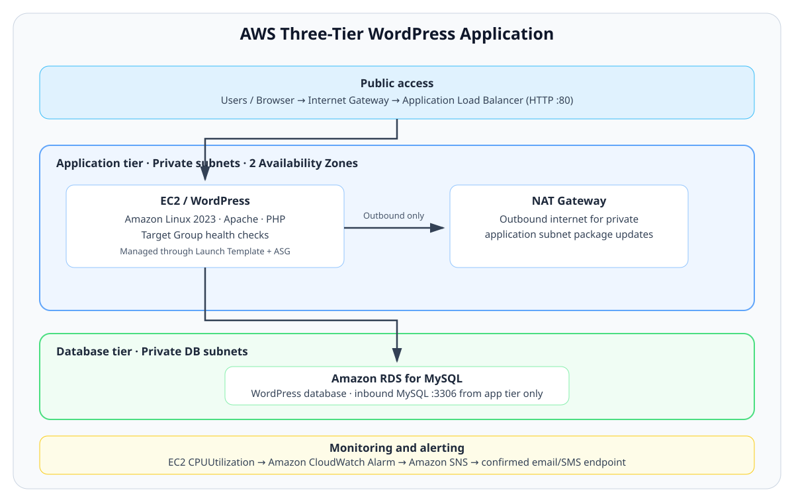

## 2. AWS services in simple words

| AWS service | What it does in this project |
|---|---|
| **VPC** | My own private network inside AWS. |
| **Subnets** | Divide the network into public, application, and database areas. |
| **Internet Gateway** | Allows internet traffic for resources configured in public subnets. |
| **NAT Gateway** | Lets private application servers access the internet for updates without being directly exposed to incoming internet traffic. |
| **EC2** | Runs the WordPress website. |
| **Apache and PHP** | Serve the website and run WordPress. |
| **Application Load Balancer** | Receives website requests and forwards them to the application server. |
| **RDS for MySQL** | Stores WordPress data in a managed database. |
| **Launch Template and Auto Scaling Group** | Define how EC2 instances are launched and manage the number of instances. |
| **CloudWatch** | Monitors EC2 metrics and evaluates the CPU alarm. |
| **SNS** | Sends alarm notifications to a configured email or SMS endpoint. Confirm the endpoint before relying on notifications. |
| **IAM** | Controls permissions for AWS services and EC2 roles. |

## 3. Network design

The VPC is named `3tire-vpc` and uses `10.0.0.0/16`. It has six subnets:

| Area | Subnet name | CIDR range |
|---|---|---|
| Public | `pub-subnet1` | `10.0.1.0/24` |
| Public | `pub-subnet2` | `10.0.2.0/24` |
| Application | `pvt-subnet1` | `10.0.3.0/24` |
| Application | `pvt-subnet2` | `10.0.4.0/24` |
| Database | `db-subnet1` | `10.0.5.0/24` |
| Database | `db-subnet2` | `10.0.6.0/24` |

**In simple terms:** the Load Balancer is in the public area, the website server is in the application area, and the database is kept in the database area.

## 4. What I configured

1. Created the VPC, six subnets, route tables, and Internet Gateway.
2. Created security groups for the Load Balancer, application server, and database.
3. Launched the Amazon Linux 2023 EC2 application server and started Apache.
4. Placed the WordPress files on the EC2 server.
5. Created the RDS MySQL database subnet group and database, then configured the WordPress database user and permissions.
6. Created an Application Load Balancer and opened the WordPress setup page through its AWS DNS address.
7. Created an EC2 Launch Template and an Auto Scaling Group. The screenshot shows one healthy instance at the configured desired capacity.
8. Created a CloudWatch CPU alarm and configured its notification action through SNS.

## 5. Screenshots and what each one shows

Each screenshot is included below its explanation. The notes describe what is visible and why the step matters.

### 01. Create the VPC

I created `3tire-vpc` with the address range `10.0.0.0/16`. This is the main network for the project.

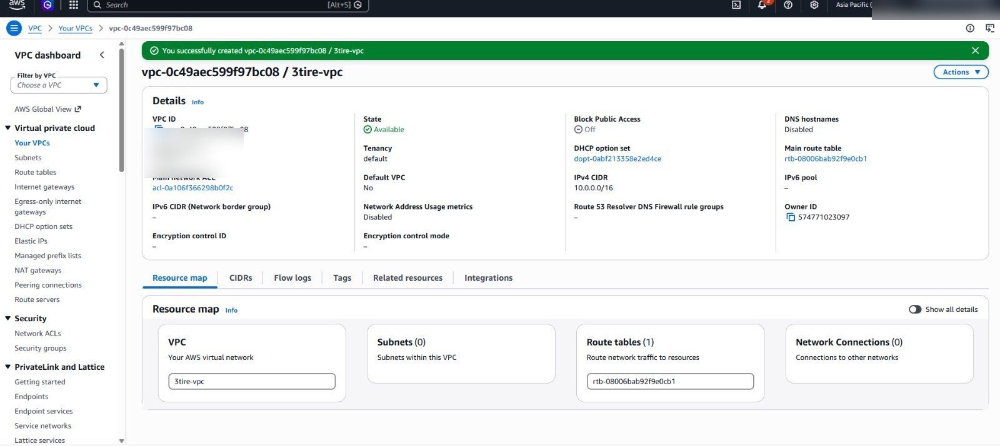

### 02. Create six subnets

I divided the VPC into two public subnets, two application subnets, and two database subnets. This keeps the different parts of the project organised.

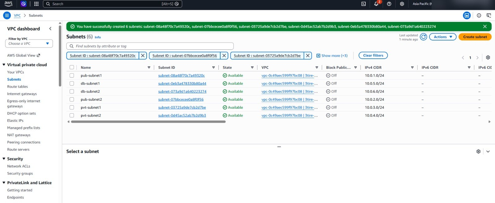

### 03. Associate the public route table

I associated the public route table with the public subnets. Public routing is needed for internet-facing resources such as the Load Balancer.

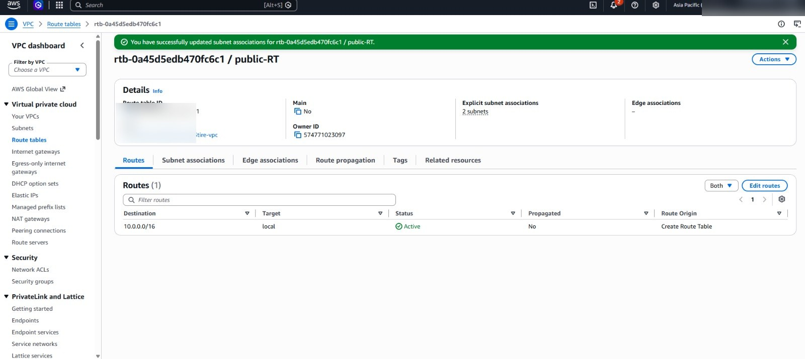

### 04. Associate the private route table

I associated the private application route table with the two application subnets. The default route should point to the NAT Gateway when private servers need outbound internet access.

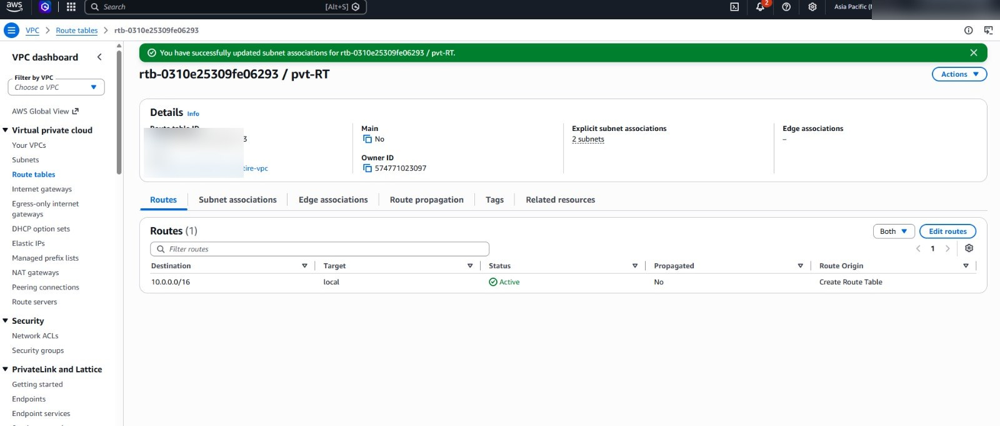

### 05. Attach the Internet Gateway

I attached an Internet Gateway to the VPC. The public route table also needs a route to this gateway for internet access.

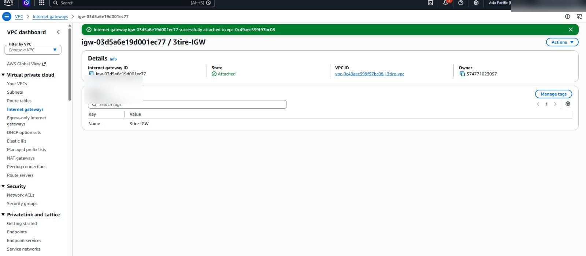

### 06. Add the public internet route

I added the route `0.0.0.0/0` to the Internet Gateway in the public route table. This sends traffic for outside networks through the Internet Gateway.

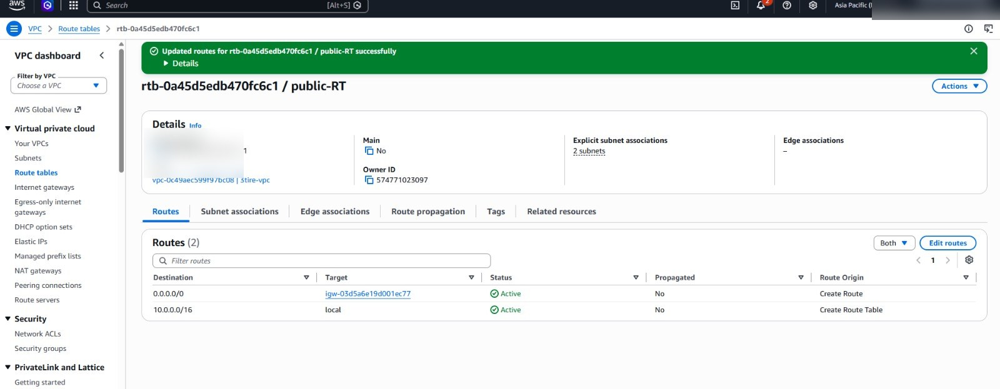

### 07. Create the NAT Gateway

I created a NAT Gateway for outbound access from private application servers. It must be Available, and the private route table must use it before this path will work.

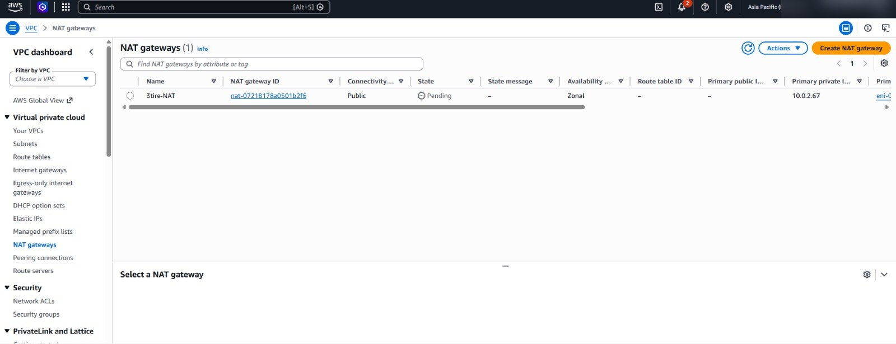

### 08. Create the Load Balancer security group

I created `LB-SG` for public website traffic. The screenshot shows HTTP on port 80 and HTTPS on port 443; HTTPS works only after a TLS listener and certificate are configured.

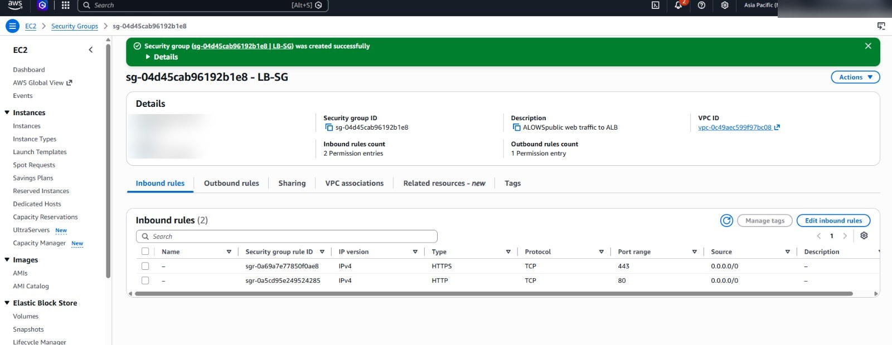

### 09. Create the application security group

I created `APP-SERVER-SG`. It allows HTTP traffic from the Load Balancer security group, instead of allowing direct website traffic from every IP address.

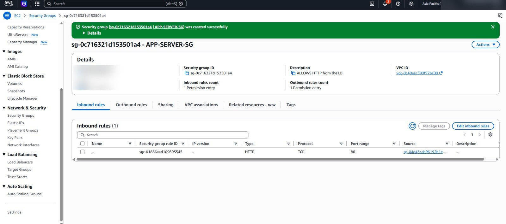

### 10. Create the database security group

I created `DB-SG` for the database layer. The database should allow MySQL traffic on port 3306 only from the application server security group.

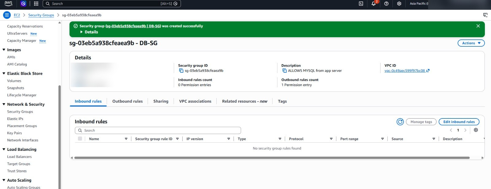

### 11. Create the EC2 Systems Manager role

I created the IAM role `EC2SSMAgent`. An appropriate role and permissions must be attached to an EC2 instance for Systems Manager access.

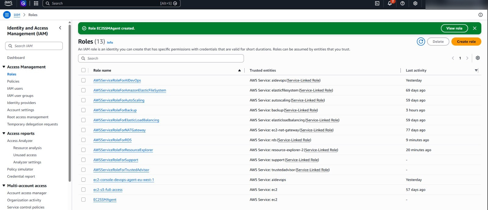

### 12. Run the application EC2 instance

The EC2 console shows the `3tire-app-server` instance in the Running state. This server hosts the WordPress application.

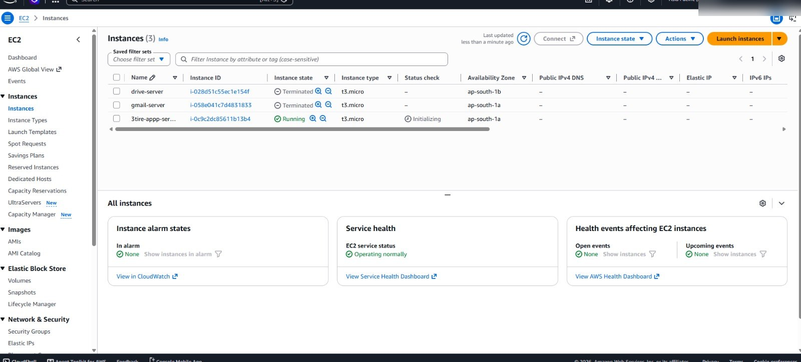

### 13. Check the operating system and disk

I checked the server's operating system and disk usage in the terminal. The output identifies Amazon Linux 2023 and shows the available disk space.

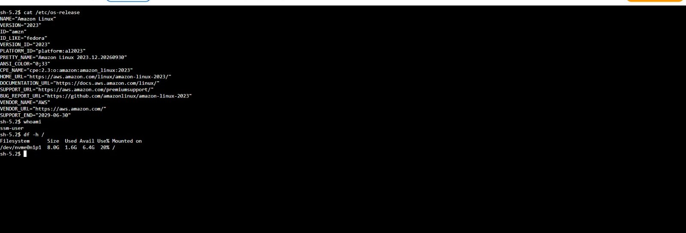

### 14. Start Apache

I started Apache and checked its service status. The terminal shows the service as active and listening on port 80.

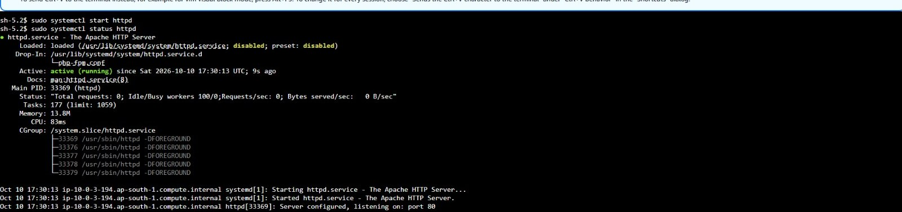

### 15. Put WordPress files on EC2

I checked the web directory and confirmed that WordPress files were present under `/var/www/html`. These are the files Apache serves for the website.

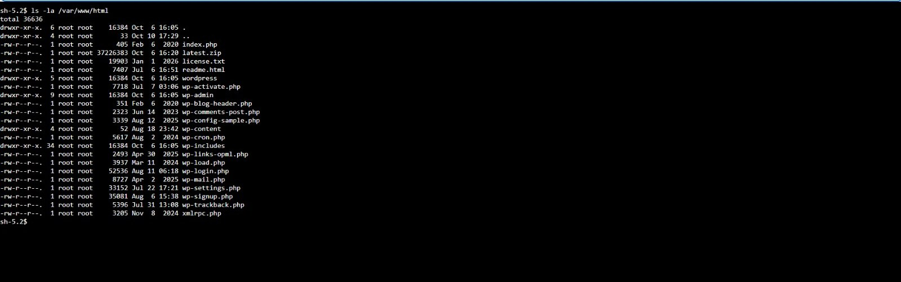

### 16. Create the RDS database subnet group

I created `private-db-subnet-group` using the private database subnets. RDS uses this group to place the database in the project's network.

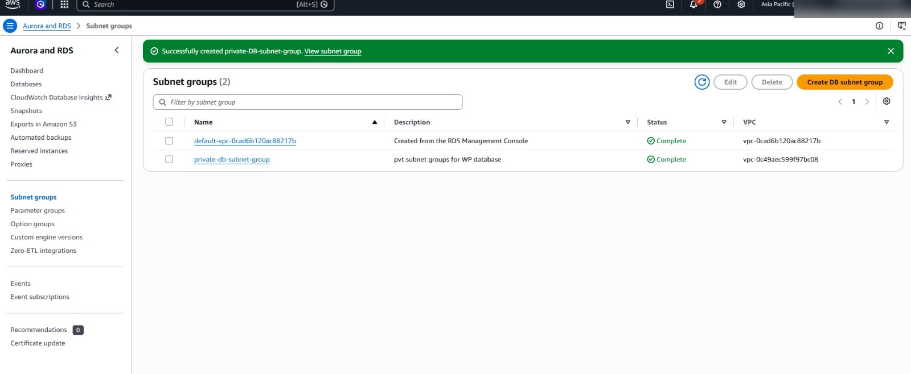

### 17. Create the RDS MySQL database

The RDS console shows `wordpress-db` in the Available state. This is the managed database used by WordPress.

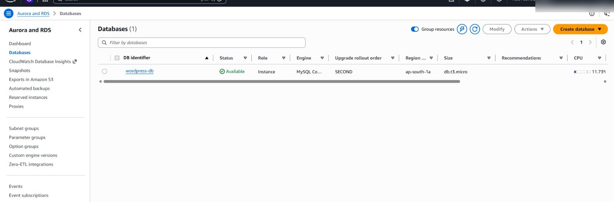

### 18. Verify the WordPress database

I connected to the MySQL database and used `SHOW DATABASES` to confirm that `wordpress` exists. The screenshot also shows that the database already existed when I tried to create it again.

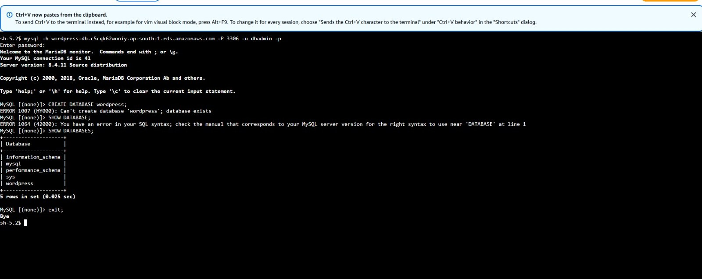

### 19. Create the WordPress database user

I created `wp_user` and granted it privileges on the `wordpress` database. The password is not included in this repository.

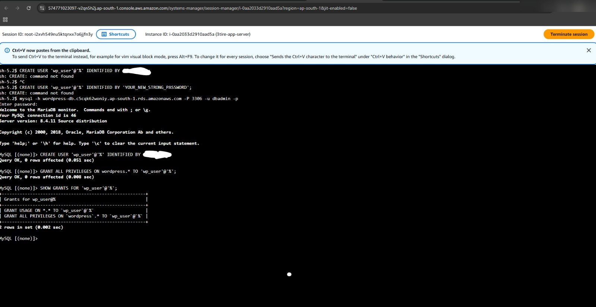

### 20. Make the Load Balancer active

The console shows `3tire-lb` as an active, internet-facing Application Load Balancer across two Availability Zones. Its DNS address was used to open the WordPress setup page.

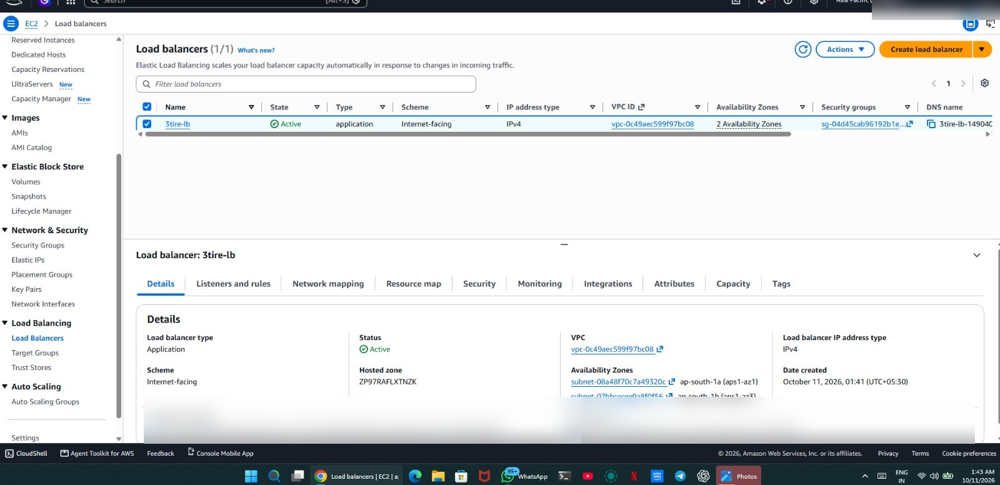

### 21. Open the WordPress setup page

I opened the Load Balancer address and reached the WordPress installation form. This confirms the setup page was reachable; finish the form and test the login separately when using the live lab.

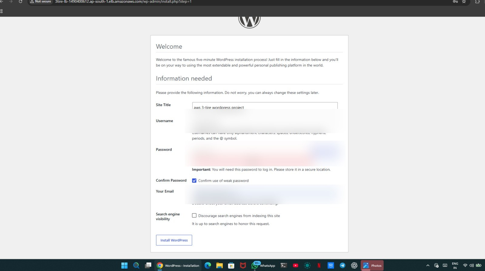

### 22. Create the EC2 Launch Template

I created `3tire-app-launch-template`. A Launch Template stores the EC2 launch settings that an Auto Scaling Group can use to start instances consistently.

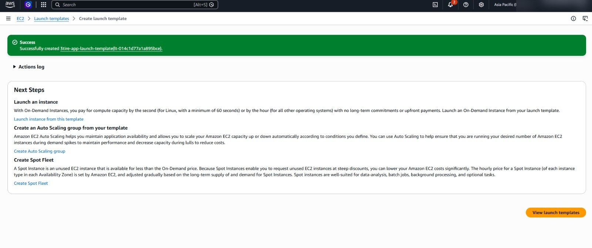

### 23. Create the Auto Scaling Group

I created `3tire-ASG`. The captured console shows one healthy instance and a desired capacity of one. This shows the group is running at its configured capacity; it is not a record of a scale-out test.

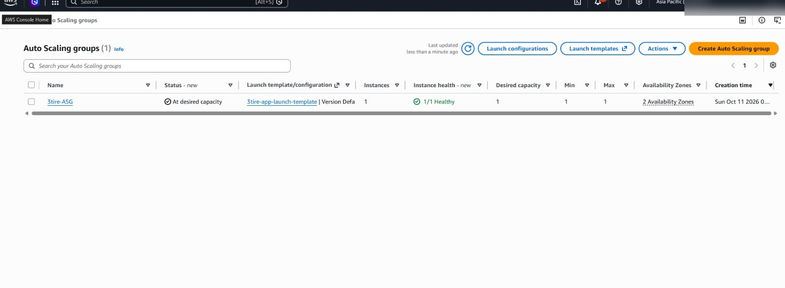

### 24. Create a CloudWatch CPU alarm

I created the `3tire-cpu-high` alarm to monitor EC2 CPU utilisation. SNS is configured for notifications; confirm the email/SMS subscription and test the alarm before relying on alerts.

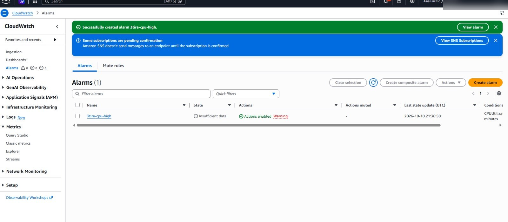

## 6. Simple project explanation for an interview

> “I built a three-tier WordPress application on AWS. I created a VPC with public and private subnets, hosted WordPress on an EC2 instance, and used an Application Load Balancer to receive website traffic. I used Amazon RDS for MySQL as the database. I also created a Launch Template and Auto Scaling Group, and configured a CloudWatch CPU alarm with SNS notifications.”

## 7. Important security and cost notes

- Do not upload AWS access keys, private keys, database passwords, WordPress passwords, or your real `wp-config.php` file.
- The lab uses the Load Balancer's AWS DNS name over HTTP. Use HTTPS and a valid certificate for a production website.
- Keep database access limited to the application server security group. Do not open database port 3306 to the whole internet.
- AWS resources can cost money, including NAT Gateway, Load Balancer, RDS, public IPv4 addresses, storage, and data transfer. Check **AWS Billing** and remove resources when you finish the lab.

## 8. More project details

- [Deployment guide](docs/deployment-guide.md)
- [Architecture notes](docs/architecture.md)
- [Screenshot index](docs/screenshot-index.md)
- [Security and cost notes](docs/security-and-cost.md)
- [Validation checklist](docs/validation-checklist.md)
